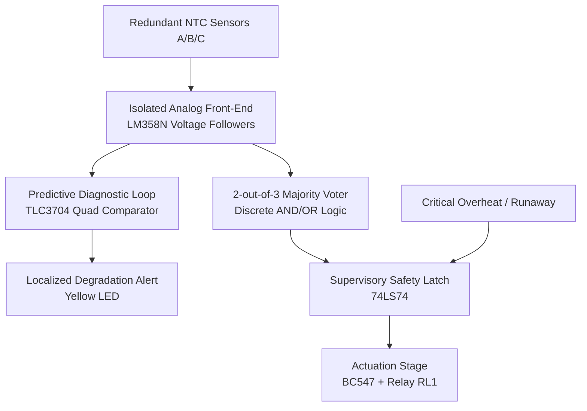

# Decoupled TMR Thermal Control Architecture

**A Decoupled Triple Modular Redundant (TMR) Thermal Control Architecture with Automated Sensor Degradation and Hardware Fallback Diagnostics**

[]()
[]()
[](LICENSE)
[]()

> Unlike traditional TMR systems that merely mask failures, this decoupled framework features **Automated Sensor Degradation Monitoring** and a **Supervisory Hardware Fallback Latch** to eliminate single-point vulnerabilities and prevent “silent” redundancy loss.

---

## Overview

This repository contains the research paper and supporting materials for a fault-tolerant discrete analog-digital thermal control architecture designed for critical industrial and aerospace applications.

Standard Triple Modular Redundancy (TMR) systems often mask individual sensor drift, leaving the platform vulnerable to unannounced secondary failures. The proposed architecture addresses this limitation through four electrically isolated functional layers:

| Layer | Role |
|-------|------|
| **Isolated Analog Front-End** | High-impedance voltage followers (LM358N) that perfectly decouple three redundant NTC thermistors |
| **2-out-of-3 Digital Majority Voter** | Rigid Boolean logic matrix that suppresses single-channel false readings |
| **Predictive Diagnostic Block** | TLC3704-based continuous comparison of each sensor against a floating group-average reference |
| **Supervisory Hardware Fallback Latch** | 74LS74 edge-triggered safe-state latch that forces instantaneous master override on severe thermal runaway |

### Core Contributions

- Eliminates inter-channel cross-talk and impedance loading
- Detects sensor degradation *before* redundancy is lost (predictive alerting via indicator)
- Provides autonomous hardware-enforced fail-safe lockout (no software dependency)
- Delivers quantified **≈ 209×** risk reduction against unannounced secondary failures

---

## Key Performance Metrics

| Metric | Classical TMR | Proposed Framework |
|--------|---------------|--------------------|
| Mathematical Reliability | \(3R^{2}-2R^{3}\) | Identical envelope |
| Drift / Degradation Detection | Silent (masked) | Active & predictive |
| Fault Coverage (injected faults) | 0 % for drift | **97 % ± 3.4 %** |
| Diagnostic Latency | N/A | **250 ms ± 14 ms** |
| Secondary Failure Risk Reduction | Baseline (1×) | **≈ 209×** |
| Steady-State Availability | Lower | Higher (\(A_{PROP} > A_{TMR}\)) |
| Hardware Fail-Safe Override | Software-dependent | Autonomous 74LS74 latch |

---

## Repository Structure

```text
.
├── README.md                          ← This file
├── LICENSE                            ← MIT License
├── CITATION.cff                       ← Citation metadata
├── docs/
│   ├── R02_Final.pdf                  ← Full research paper (7 pages)
│   ├── architectural_overview.md      ← Layer-by-layer description
│   ├── reliability_analysis.md        ← Reliability, Markov & RRF models
│   └── design_philosophy.md           ← Safety & maintainability rationale
├── hardware/
│   ├── bom/
│   │   └── bill_of_materials.md       ← Key components from the paper
│   └── schematic/
│       └── notes.md                   ← Schematic description & equations
├── analysis/
│   └── equations.md                   ← Core equations extracted from the paper
└── assets/                            ← Reserved for future figures / photos
```

---

## System Architecture (High-Level)



**Final Actuation Logic**

\[
F_{OUT} = Y \land CRT
\]

where \(Y\) is the majority-voted signal and \(CRT\) is the critical-lockout latch output.

---

## Reliability Highlights

- Classical TMR reliability: \( R_{TMR} = 3R^{2} - 2R^{3} \)
- MTTF of the 2-out-of-3 sensing layer: \( MTTF_{TMR} = \dfrac{5}{6\lambda} \)
- Diagnostic-assisted Markov model introduces state \(S_{3D}\) (early degradation detected) enabling proactive maintenance
- Risk Reduction Factor (RRF) against secondary failure ≈ **209×** (for \(\lambda = 10^{-4}\,h^{-1}\), \(T_r = 24\,h\))

Full derivations, uncertainty analysis, and comparative tables are in `docs/reliability_analysis.md` and the paper itself.

---

## Authors

**Syed Umar Ali**  
Department of Industrial Electronics Engineering  
IIEE-NEDUET  
Email: umarali.35@iiee.edu.pk

---

## Citation

If you use this work, please cite the paper and/or this repository:

```bibtex
@misc{ali2024decoupledtmr,
  author       = {Ali, Syed Umar},
  title        = {A Decoupled Triple Modular Redundant (TMR) Thermal Control Architecture with Automated Sensor Degradation and Hardware Fallback Diagnostics},
  year         = {2024},
  howpublished = {\url{https://github.com/umarali-lumo/Decoupled-TMR-Thermal-Control-Architecture}},
  note         = {Research repository}
}
```

See `CITATION.cff` for machine-readable citation data.

---

## License

This repository is released under the **MIT License**.  
The research paper and technical content remain the intellectual property of the author. See `LICENSE` for full terms.

---

## Notes

- This is a **research / documentation** repository. Full discrete schematic netlists, PCB layout files, and experimental raw logs are not included (they were not retained by the author).
- The architecture is fully described in the accompanying paper (`docs/R02_Final.pdf`).
- For collaboration, verification, or commercial licensing inquiries, contact the author directly.
